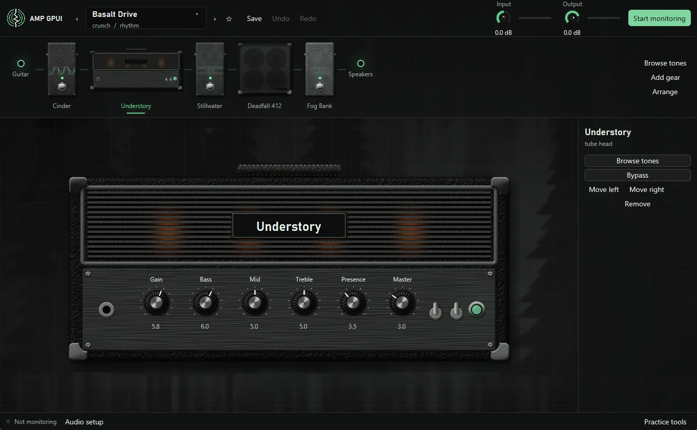

# Amp GPUI



A desktop guitar amp and effects rig written in Rust. Plug a guitar into an
audio interface, load an amp tone, and play through your speakers, with no
pedal or modeler box in between.

Amps are [Neural Amp Modeler](https://www.neuralampmodeler.com/) captures
(`.nam`), cabinets are impulse responses (`.wav`), and tones live in a plain
folder you own and can share however you like. NAM A2 captures hold several
model sizes, and the amp's Quality knob trades CPU for detail between them.

The [documentation](https://joeyf116.github.io/amp-gpui/) has a user guide and
explains how everything works. Its source is in `docs`.

## Run it

```bash
cargo run -p amp-app
```

On Windows, build from PowerShell. Git Bash puts its own `link.exe` ahead of
the MSVC one.

Then open **Audio setup** at the bottom left, pick your interface under **Guitar
in** and your speakers under **Speakers out**, and press **Start monitoring**. Turn off your
interface's own direct monitoring so you only hear the processed signal.

To check a device pair without making a sound:

```bash
cargo run -p amp-engine --example device_check -- --run --input "Mic 1" --output "USB Out 1/2"
```

## Layout

| Crate | Job | Runs on |
| --- | --- | --- |
| `amp-dsp` | Blocks and the chain: gate, drive, NAM amp, IR cab, delay | Audio thread |
| `amp-engine` | Devices, resampling, clock drift, UI to audio messaging | Audio thread and UI thread |
| `amp-preset` | Preset format, tone library, tone packs | Background threads |
| `amp-tone3000` | TONE3000 sign-in, tone lists, downloads | Background threads |
| `amp-assistant` | The tone assistant: Claude client, tools, chats, taste | Its own thread |
| `amp-secret` | Small files encrypted to the Windows account | Background threads |
| `amp-app` | The GPUI interface | UI thread |

## How the audio path works

```text
interface -> queue -> resample to 48 kHz -> chain -> resample to device -> speakers
```

- The input and output can be separate devices with separate clocks, because
  interface in and computer speakers out is the main use case. A cubic
  resampler adapts to differing rates, and the input ratio is continually
  nudged to keep the queue between the devices at a fixed depth.
- The chain always runs at 48 kHz, in 64-frame blocks.
- Nothing on the audio thread allocates, locks, or blocks. The UI sends changes
  through a lock-free queue, new chains are built in the background and swapped
  in whole, and old chains go back to the UI thread to be freed.

## Tone library

A library is a folder with `presets/*.json` and `assets/<sha256>.<nam|wav>`.
Because a preset refers to files by content hash, it means the same thing
wherever it goes. Put the folder in git, a synced drive, or a network share to
share a whole library. Export writes a tone pack, which is the same layout with
one preset. Importing a pack re-hashes every file before accepting any of it.

`.nam` and `.wav` files are ignored by this repo, since captures often have
their own licenses. Check a capture's terms before sharing it in a pack.

## Tone assistant

Press **Assistant** (Ctrl+J) to chat with Claude beside the rig, using your own Anthropic
API key. It builds and changes tones, picks captures from your gear and TONE3000 lists, and
learns your taste from what you keep and adjust. Nothing changes until you press **Try
it**. See the [guide](docs/guide/assistant.md).

## Practice tools

Press T for a tuner, a metronome, and a fretboard that shows a key and scale and
lights up the notes you play. Load an MP3 to get its melody, chords, and beats as
scrolling tab, then slow it down, loop it, fix the notes, and see how you played.

## Controls

| Action | How |
| --- | --- |
| Turn a knob | Drag up or down, or scroll |
| Fine adjustment | Hold Shift while dragging or scrolling |
| Reset a knob | Double-click it |
| Put a block on the stage | Click its card |
| Add a block | + between two blocks, + Add block, or G |
| Replace a block | Replace on its card |
| Switch a block on or off | On or Off on its card, or select it and press B |
| Select a block | Left and Right |
| Move a block | Drag its card, or Alt+Left and Alt+Right |
| Remove a block | Remove on its card, or Delete |
| Undo and redo | Ctrl+Z, and Ctrl+Y or Ctrl+Shift+Z |
| Previous or next tone | Page Up and Page Down |
| Start or stop monitoring | M |
| Practice tools | T |
| Metronome on or off | K |
| Tone Explorer | Ctrl+O |
| Gear picker | G |

## Status

Choose your interface's ASIO driver under **Audio driver** for the lowest
latency, which reports about 8 ms on a FLOW 8. With **Windows audio**, exclusive
mode reports about 17 ms and takes over the devices while it runs, and **Shared
audio** keeps other apps playing at about 40 ms or more. Building ASIO needs
LLVM, and the first build downloads Steinberg's ASIO SDK.

## License

Amp GPUI is free software under the [GNU General Public License, version 3](LICENSE).
It uses the Steinberg ASIO SDK under that license's terms.

ASIO is a registered trademark of Steinberg Media Technologies GmbH.