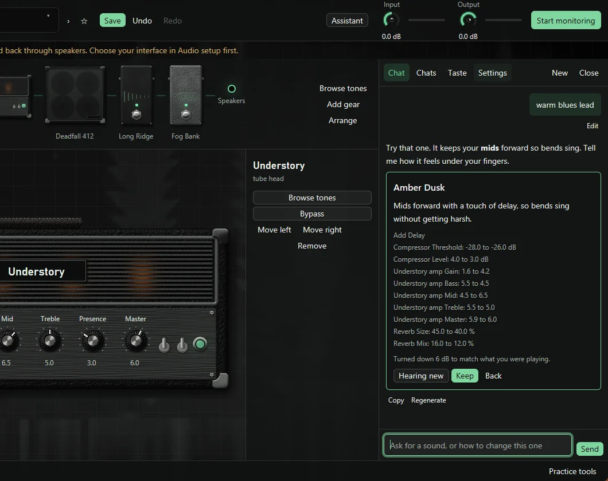

# Ask the tone assistant

The tone assistant is a chat beside your rig. Describe a sound, or say what you want
changed, and it builds a tone you can try with one press. It's made for playing:
the panel sits next to the chain, so you can keep your hands on the guitar.

## Set it up

The assistant runs on Claude, through your own Anthropic API key. Requests are billed
by Anthropic, separately from any Claude plan. Expect a few cents per reply on Claude
Opus 5.5 and a fraction of a cent on Haiku 5.5. Those are estimates from list prices, and
the Settings page shows what the session has really used.

1. Press **Assistant** in the header, or ++ctrl+j++.
2. Press **Get a key from the Claude Console** and create a key.
3. Paste it in and press **Save key**. The app checks it first.

The key is encrypted to your Windows account and only ever goes to Anthropic. It's
never put in a tone, a pack, or your settings file. **Remove key** deletes it. There's
no "Sign in with Claude" because
[Anthropic doesn't allow other apps to offer one](https://code.claude.com/docs/en/legal-and-compliance).

## Ask for a sound

Type what you're after and press ++enter++. ++shift+enter++ starts a new line.

- "Warm blues lead, like Texas Flood."
- "Tighten this up and take off some fizz."
- "What does the compressor do in this tone?"
- "I just started playing. Build me something easy to sound good with."

It knows what's loaded, so you never need to describe your rig. Say you're a beginner
and it explains things as it goes. Say you've played for 20 years and it gets to the
point.

## Try a suggestion

A suggestion arrives as a card. New tones show their chain, and changes to the loaded
tone list each knob that moves. Nothing happens to your rig until you press **Try it**.

| Control | What it does |
| --- | --- |
| **Hearing new** or **Hearing old** | Flips between the suggestion and what you had. ++ctrl+b++ does the same |
| **Keep** | Saves it as a tone. A new tone never replaces one you have. A change to the loaded tone saves over it, like **Save** |
| **Back** | Returns to what you had |

Turn any knobs you like while you try a suggestion, and your changes stay with it.
**Undo** works as usual.

!!! warning "Start with your volume low"

    Claude can't hear the result. The app measures each suggestion on a test chord and
    turns it down if it runs more than 2 dB over what you were playing, and the card says
    so when it does. That catches most surprises, but a tone that feels fine on a test
    chord can still jump out under your fingers.

## Real amps and pedals

Built-in blocks always work and need no downloads, so they're the default. Ask for a
specific amp or pedal and the assistant looks for a capture:

1. **Your gear** comes first, since those captures are already here.
2. **Your TONE3000 lists** come next: favorites, downloads, and creations, plus trending
   and latest. You need to be [signed in](tone3000.md) for these.
3. **The TONE3000 picker** covers everything else. The assistant can't search their
   catalog, because their free API doesn't allow it, so it tells you what to look for and
   gives you a **Browse TONE3000** button. Pick a tone there, and it comes back into the
   chat.

The card shows the capture's picture, creator, and license before anything downloads.
The button reads **Download and try**, and pressing it is what downloads the model. After
that the tone works immediately, and later it loads like any other tone.

## Chats

**Chats** lists your saved chats, where you can open, rename, or delete them. **New**
starts a fresh one. **Stop** ends a reply and keeps what was written, **Regenerate** asks
again, and **Edit** puts your last message back in the box. **Copy** copies a reply.

Chats are saved on this PC. A reopened chat keeps what was said and suggested, but not
the TONE3000 lists Claude read along the way, since TONE3000's terms don't allow keeping
them.

## What it learns about you

The **Taste** page shows everything the assistant knows about you.

- **What you've said.** Tell it about your guitar, your pickups, or what you can't stand,
  and it remembers. A note in the chat shows when it does.
- **What it's noticed.** It tracks which tones you keep and back out of. It also watches
  how you adjust suggestions you keep. If you keep turning the treble down, it'll start
  suggesting less.

Press **Forget** on a line, or **Forget everything**, to delete it. Turn off **Learn from
what I keep and adjust** and nothing new is learned, and what's there stops being sent.
Your taste is stored on this PC, under your Windows account, so it doesn't follow you to
another computer.

## Privacy

Each request sends Anthropic your message, the loaded tone, the taste page, and whatever
the assistant reads to answer, such as tone names and TONE3000 list entries. Your audio
and your model files are never sent. Anthropic's terms for your key apply.

## Which model

Choose in Settings. Claude Opus 5.5 is the default and thinks hardest, Sonnet 5.5 costs
about half as much, and Haiku 5.5 is the cheapest and fastest by far. Try Haiku first if
cost matters to you.

Wah, phaser, tremolo, pitch shifting, and stereo aren't available as blocks, so the
assistant will tell you if a sound depends on one.
