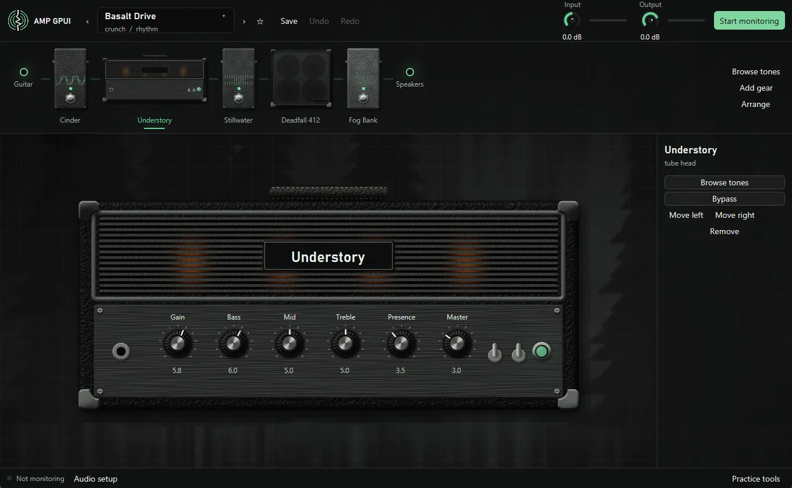
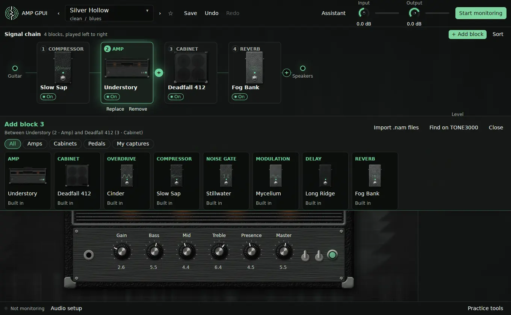

# Build a rig

The **signal chain** across the top of the window is your rig, and the one place
where you add, replace, remove, move, and switch blocks. It runs from your guitar
on the left to your speakers on the right, and sound passes through the blocks in
that order. Below it, the stage shows the selected block up close, with its knobs.

Every block is a card that says what it is before anything else:

- **Its number**, counted from the guitar, so "block 3" always means the same one.
- **What it does**, such as OVERDRIVE, AMP, or CABINET, above its own name. Gear
  has original names like Cinder or Deadfall 412, and the type keeps them clear.
- **Its picture and name**, which is the capture's own name for your captures.
- **Its switch**: **On**, **Off**, or **File missing**. Click it to switch the block.

The selected card is lit in green, and the stage and the panel beside it repeat
its number, type, and name, so the knobs always say whose they are. Hover over a
card for a reminder of what it is.

Each type of pedal has its own paint and printed graphic, so you can tell them
apart at a glance:

| Paint | Type |
| --- | --- |
| Blue | Compressor |
| Magenta | Fuzz |
| Yellow | Boost |
| Orange | Overdrive |
| Red | Distortion |
| Black | Noise gate |
| Teal | Modulation |
| Violet | Delay |
| Pale silver | Reverb |
| Brushed aluminum | Pedal capture of another kind |

The same color runs along the top of each card in the chain and the picker, and
colors its type name. Amps and cabinets stay black. When a tone comes with its own
picture, such as one from TONE3000, the picture goes on the unit like a label.

## Add, replace, move, and remove blocks

- **Add a block:** press the **+** between two blocks, or after the last one. The
  gear picker opens right under the chain and says where the block will go, such
  as "Between Understory (2 · Amp) and Deadfall 412 (3 · Cabinet)". Click any gear
  in it to put it there. **+ Add block**, or ++g++, opens the same picker for the
  spot after the selected block, or, with nothing selected, where that kind of gear
  usually goes.
- **Replace a block:** hover over its card and press **Replace**, or press
  **Replace** in the panel beside the stage. The picker opens for that spot. A
  capture of the same kind keeps the block's knob settings.
- **Move a block:** drag its card, or select it and press ++alt+left++ or
  ++alt+right++. You can also drag gear from the picker straight to any gap.
- **Remove a block:** hover over its card and press **Remove**, or select it and
  press ++delete++. ++ctrl+z++ brings it back.
- **Switch a block on or off:** click **On** or **Off** on its card, press the
  footswitch of a pedal on the stage, or select it and press ++b++.
- **Tidy up:** **Sort** puts the chain into a common order. It's a guideline,
  and you can drag anything back out of it.

The picker's tabs narrow it to **Amps**, **Cabinets**, **Pedals**, or **My
captures**. ++esc++ closes it. The picker opens in line, so it moves the stage
down rather than covering it. When the window is too short for everything, scroll
the board.

The usual order is compression and drives first, then the gate, amp, and cabinet,
then modulation, delay, and reverb.

To keep one rig but change which units are on and how they're set, for a verse
and a solo, use [scenes](scenes.md).

Click a block to put it on the stage. Pedals, amps, and captures have their knobs
on the faceplate. The arrows either side of its name on the stage step to the
blocks either side of it. A cabinet's **Level** knob sits in the panel beside it. Every
edit can be undone with ++ctrl+z++. See [Keyboard and mouse](controls.md) for
all the controls.

## Built-in gear

These all work with no files.

| Name | Type | What it does | Controls |
| --- | --- | --- | --- |
| Understory | Tube head | An original amp model | Gain, Bass, Mid, Treble, Presence, Master |
| Deadfall 412 | 4x12 cabinet | An original closed-back cabinet voice | Level |
| Slow Sap | Compressor | Evens out picking dynamics | Threshold, Ratio, Release, Level |
| Cinder | Overdrive | A soft-clipping drive for pushing an amp | Drive, Level |
| Stillwater | Noise gate | Cuts hum between notes | Threshold, Release |
| Mycelium | Chorus | One modulated delay line | Rate, Depth, Mix |
| Long Ridge | Delay | Repeats of up to 1.5 seconds | Time, Feedback, Mix |
| Fog Bank | Reverb | A plate-like reverb | Size, Damping, Mix |

## Add your own amps and pedals

Open the gear picker and press **Import .nam files**, then choose one or more
capture files. Each one is checked, copied into your library, and listed in the
picker under **Amps** or **Pedals**, depending on what the file says it is, and
under **My captures**. Add it to the chain like any other block. A capture's own name goes on its faceplate, and a pedal capture
picks its look from words in that name, such as `fuzz` or `delay`.

A capture has three controls:

| Control | What it does |
| --- | --- |
| Input | The level going into the capture, which is usually what changes its gain |
| Output | The level coming out |
| Quality | Trades CPU for detail, on captures that support it |

Captures need to be **48 kHz**, which most are. The app can't resample a capture
yet, so a capture at any other rate passes your signal through, and its panel says
why. The rest of the rig keeps playing.

### Compare captures in the same spot

To hear one capture against another with everything else the same, press
**Replace** on the amp or pedal block and pick another capture of that kind. The
picker marks those **Keeps the knobs**: the new capture takes the block's place,
keeping the Input, Output, and Quality settings and its spot in every scene.

You can also drag a capture from the picker onto a block of the same kind. The
card lights up, and dropping there swaps it instead of adding a new block.

Captures often have their own license, so check the terms of any file before you
share it. The [NAM project](https://www.neuralampmodeler.com/) has tools for
making your own from gear you own.

### NAM A2 captures

NAM A2 files hold several model sizes in one capture. The **Quality** knob moves
between them, so if you get glitches, lower it before you change anything else.
On other captures, it does nothing.

## Use your own cabinet

1. Select a cabinet in the chain.
2. Press **Load cab IR** in the panel beside it, and choose a `.wav` impulse
   response.

The cabinet opens up to show bare speakers, and the file's name replaces its own.
The file is copied into your library. Stereo files are mixed to mono, the rate
is converted to match the app, and only the first half second is used. Longer
files are mostly room sound and cost CPU on every block.

!!! warning "Watch for two cabinets"

    Some captures already include a cabinet. If yours does, the app warns you, and
    you should remove the cabinet from the chain so you don't hear two.

## What makes a good gain structure

- Set **Input** in the header so hard picking is near the top of its meter
  without turning it red.
- Use **Output** in the header for your overall volume. It doesn't
  change your tone.
- On the Understory amp, raising **Gain** adds dirt without much of a jump in
  volume, because the output is trimmed to match. **Master** sets the level.
- Put the noise gate after your drives, so it can catch their hiss.
