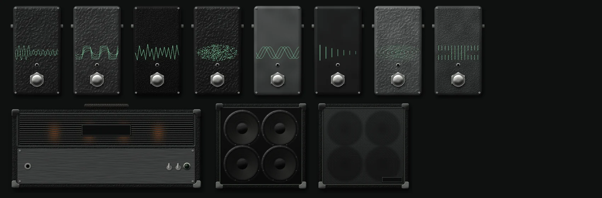

# Build a rig

The chain strip across the top of the window is your rig. It runs from your
guitar on the left to your speakers on the right, and sound passes through the
units in that order. Below it, the stage shows the selected unit up close, with
its knobs. **Add gear** opens the gear drawer, which holds everything you can add.

Pedals share one muted finish, and each type has its own printed graphic. When a
tone comes with its own picture, such as one from TONE3000, the picture goes on the
unit like a label.

## Add, move, and remove gear

- **Add a unit:** press **Add gear**, or ++g++, then drag a unit from the drawer
  to where you want it in the chain. Double-clicking it in the drawer places it
  where that kind of gear usually goes.
- **Move a unit:** drag it, or select it and press ++alt+left++ or ++alt+right++.
- **Remove a unit:** select it and press ++delete++, or drag it to the open drawer.
- **Bypass a pedal:** press its footswitch, or select it and press ++b++.
- **Tidy up:** **Arrange** sorts the chain into a common order.
  It's a guideline, and you can drag anything back out of it.

The usual order is compression and drives first, then the gate, amp, and cabinet,
then modulation, delay, and reverb.

To keep one rig but change which units are on and how they're set, for a verse
and a solo, use [scenes](scenes.md).

Click a unit to put it on the stage. Pedals, amps, and captures have their knobs
on the faceplate. A cabinet's **Level** knob sits in the panel beside it. Every
edit can be undone with ++ctrl+z++. See [Keyboard and mouse](controls.md) for
all the controls.

## Built-in gear

These all work with no files.

| Name | Type | What it does | Controls |
| --- | --- | --- | --- |
| Understory | Tube head | An original amp model | Gain, Bass, Mid, Treble, Presence, Master |
| Deadfall 412 | 4x12 cabinet | An original closed-back cabinet voice | Level |
| Slow Sap | Compressor | Evens out picking dynamics | Threshold, Ratio, Release, Level |
| Cinder | Overdrive | A soft-clipping drive for pushing an amp | Drive, Level |
| Stillwater | Noise gate | Cuts hum between notes | Threshold, Release |
| Mycelium | Chorus | One modulated delay line | Rate, Depth, Mix |
| Long Ridge | Delay | Repeats of up to 1.5 seconds | Time, Feedback, Mix |
| Fog Bank | Reverb | A plate-like reverb | Size, Damping, Mix |

## Add your own amps and pedals

Press **Add .nam** in the gear drawer and choose one or more capture files. Each one is
checked, copied into your library, and listed under **Amp captures** or **Pedal
captures**, depending on what the file says it is. Drag it onto the chain like
any other unit. A capture's own name goes on its faceplate, and a pedal capture
picks its look from words in that name, such as `fuzz` or `delay`.

A capture has three controls:

| Control | What it does |
| --- | --- |
| Input | The level going into the capture, which is usually what changes its gain |
| Output | The level coming out |
| Quality | Trades CPU for detail, on captures that support it |

Captures need to be **48 kHz**, which most are. The app can't resample a capture
yet, so a capture at any other rate passes your signal through, and its panel says
why. The rest of the rig keeps playing.

### Compare captures in the same spot

To hear one capture against another with everything else the same, select the amp
or pedal unit. Its panel lists your other captures of that kind under **Swap
capture**. Click one and it takes the unit's place, keeping the Input, Output, and
Quality settings and its spot in every scene.

You can also drag a capture from the gear drawer onto a unit of the same kind. The
unit lights up, and dropping there swaps it instead of adding a new unit.

Captures often have their own license, so check the terms of any file before you
share it. The [NAM project](https://www.neuralampmodeler.com/) has tools for
making your own from gear you own.

### NAM A2 captures

NAM A2 files hold several model sizes in one capture. The **Quality** knob moves
between them, so if you get glitches, lower it before you change anything else.
On other captures, it does nothing.

## Use your own cabinet

1. Select a cabinet in the chain.
2. Press **Load cab IR** in the panel beside it, and choose a `.wav` impulse
   response.

The cabinet opens up to show bare speakers, and the file's name replaces its own.
The file is copied into your library. Stereo files are mixed to mono, the rate
is converted to match the app, and only the first half second is used. Longer
files are mostly room sound and cost CPU on every block.

!!! warning "Watch for two cabinets"

    Some captures already include a cabinet. If yours does, the app warns you, and
    you should remove the cabinet from the chain so you don't hear two.

## What makes a good gain structure

- Set **Input** in the header so hard picking is near the top of its meter
  without turning it red.
- Use **Output** in the header for your overall volume. It doesn't
  change your tone.
- On the Understory amp, raising **Gain** adds dirt without much of a jump in
  volume, because the output is trimmed to match. **Master** sets the level.
- Put the noise gate after your drives, so it can catch their hiss.
