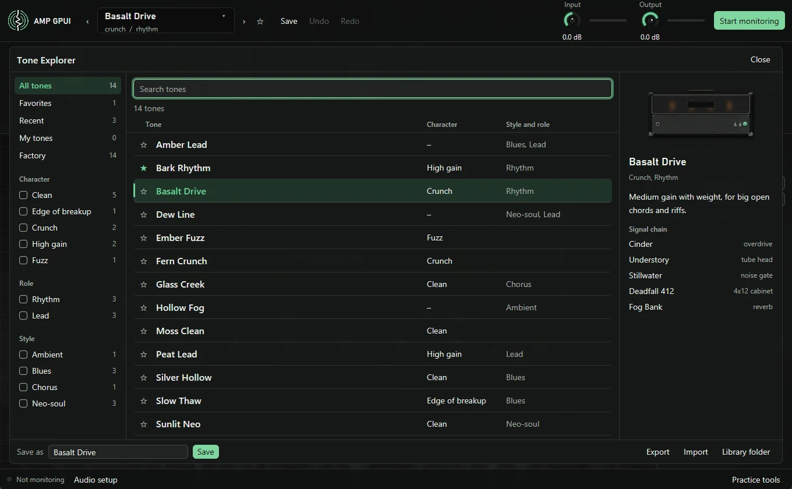

# Load and save tones

A tone is a saved rig: every unit in the chain, in order, with its settings. The
tone name in the header shows what's loaded, and an asterisk means it has unsaved
edits.

## Load a tone

Press the arrows beside the name, or ++page-up++ and ++page-down++, to step through
your tones.

For everything else, click the name or press ++ctrl+o++ to open the **Tone
Explorer**.

- **Shelves:** the left side sorts tones into **All tones**, **Favorites**,
  **Recent**, **Factory**, **My tones**, and one shelf per tag.
- **Search:** type in the top box. It matches names, tags, and notes.
- **Favorites:** press the star on a tone, or the star in the header.
- **Compare:** click a tone to load it while the Explorer stays open, so you can
  try several as you play. Double-click one, or press ++esc++, to close.

 Tones load in the background and crossfade in, so you can switch while
you're playing. Delay and reverb tails from the old tone stop as it fades out.

If a tone can't load, for example because a file it needs is missing, the current
tone keeps playing and an error line tells you why.

The app reopens the last tone you used.

## Factory tones

A new library starts with these 14 tones. They use only built-in blocks, so
they need no captures or impulse responses.

| Tone | Style | Sound |
| --- | --- | --- |
| Moss Clean | Clean | A warm, even clean for chords and fingerstyle |
| Glass Creek | Clean, chorus | Bright clean with a slow shimmer and a short slap |
| Silver Hollow | Clean, blues | A glassy, round clean with light compression and a plate-style reverb |
| Sunlit Neo | Clean, neo-soul | A shimmering clean for chord melodies and fills |
| Velvet Pocket | Clean, neo-soul, rhythm | A tight, percussive clean for funky rhythm and double-stops |
| Slow Thaw | Blues, edge of breakup | Warm edge of breakup, with a light drive left on as a gentle push |
| Fern Crunch | Crunch | Edge of breakup. Dig in to bite, or ease off to clean up |
| Basalt Drive | Crunch, rhythm | Medium gain with weight, for big open chords and riffs |
| Bark Rhythm | High gain, rhythm | Tight palm mutes, with a drive trimming the lows going into the amp |
| Peat Lead | High gain, lead | Singing mids for solos, with a delay trailing behind the notes |
| Amber Lead | Blues, lead | A vocal lead with a mid push, for long bends over a soft delay |
| Dew Line | Neo-soul, lead | A singing, airy lead with a light chorus and a lush tail |
| Ember Fuzz | Fuzz | A woolly wall of sustain, driving a mostly clean amp |
| Hollow Fog | Ambient | Long washes for swells and slow chords |

!!! note

    The factory tones were set by measuring levels and clipping. They'll change
    as they get tuned by ear.

## Save a tone

**Save** in the header writes your edits to the tone that's loaded.

To save a copy, open the Tone Explorer, type a new name in the box at the bottom,
and press **Save under this name**. Saving under the name of an existing tone
replaces it. That's also the way
to rename a tone or start a variation.

A name needs at least one letter or number. Two names that differ only in
punctuation or case, like `Lead #2` and `lead 2`, share one file, so the second
save replaces the first.

## Delete a tone

There's no delete button yet. Delete the tone's `.json` file from the library's
`presets` folder, then restart the app. **Library folder** in the Tone Explorer
chooses where that folder is. Factory tones you delete stay deleted.
