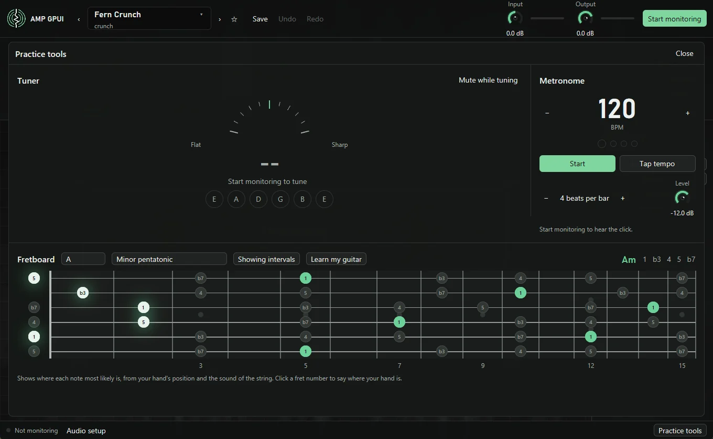

# Tune and practice

Press **Practice tools** at the bottom right, or ++t++, to open the tuner,
metronome, and fretboard together.

Monitoring has to be running for the tuner, the click, and the fretboard's live
notes. Press ++m++ first.

## Tuner

Play one open string. The needle shows how far off the note is, and the words under
it say which way to turn the peg. The needle centers and turns green within 3 cents
of the note. The six circles light up when you land on a standard tuning string.

The tuner reads your guitar before the **Input** knob, so it still works with the
input turned down. **Mute while tuning** silences your rig while the panel is open.

## Metronome

- **Start and stop:** press **Start**, or press ++k++ from anywhere in the app. While
  it's running, the footer shows the tempo and a light on the first beat.
- **Set the tempo:** press **+** and **−**, scroll over the number, or press **Tap
  tempo** in time. Tempo runs from 30 to 300 BPM.
- **Set the bar:** the first beat of each bar has a higher click. Choose from 1 to 12
  beats per bar.
- **Set the level:** the **Level** knob sets the click on its own, so **Output** can
  change without changing it.

The click runs on the audio thread, so it stays in time however busy the app is. It
goes straight to your speakers and doesn't pass through your rig.

## Fretboard

Choose a key and a scale, and the fretboard marks every note of that scale on the
first 15 frets. The root is green. **Showing notes** switches the labels between note
names and intervals, such as `b3` and `5`, and the row at the right spells the scale
out.

Play a note and one spot lights up: where you most likely played it. Play a chord
and its name appears above the neck, with its shape lit on the strings.

### How it finds the spot

The same pitch exists in up to five places on a guitar, and pitch alone can't say
which. The fretboard uses two clues:

- **Your hand.** It follows where you've been playing, and assumes the next note is
  close by. To tell it directly, click a fret number under the neck.
- **The string.** Thicker, shorter strings are stiffer, which shifts their high
  overtones. Once a note has rung for about a third of a second, the fretboard reads
  that and can move the note to the string that fits.

Press **Learn my guitar** and pluck each open string when asked, low E first. It
measures your actual strings, which makes that second clue much stronger. Do it again
after changing string gauge.

It's a best guess, not a certainty, and the first note of a phrase is the hardest,
since there's no hand position to go on yet. Clean tone isn't needed, because it reads
your guitar before the amp, but the bridge pickup and a clean pick attack help.

| Color | Meaning |
| --- | --- |
| Green | The root of the key |
| Gray | Another note of the scale |
| White | What you just played, in the scale |
| Amber | What you just played, outside the scale |

### Chords

Chords are heard by finding the note that best explains the sound, removing it, and
repeating. The fretboard shows a chord once it holds steady, which takes about a
quarter of a second. It names major, minor, power, seventh, sixth, suspended, add9, ninth,
diminished, and augmented chords, with slash chords when the bass isn't the root.

A chord's shape on the neck is the one a single hand could hold nearest your position,
so an unusual voicing can land elsewhere. An octave can hide in the overtones of the
note below it, so strings skipped inside a shape are filled with a chord tone under
your hand, and a string you muted there can show as played. Very fast changes and heavily muted strums
are harder to hear.

On modeled guitars with deliberately untidy strings, chords were named correctly 97
percent of the time, and the string was right about 76 percent of the time from the
sound alone, before hand position or learning. Those aren't measurements on a real
guitar, so yours will differ.

The included scales are minor and major pentatonic, blues, major, natural, harmonic,
and melodic minor, and the Dorian, Phrygian, Lydian, Mixolydian, and Locrian modes.

## Learn a song's melody

Press **Load song** under the neck and pick an MP3. WAV, FLAC, and Ogg files work too.
The app listens to the whole song, which takes a few seconds, and writes out the melody
as tab.

- **Play along:** press ++m++ to start monitoring, then **Play**. The song comes through
  your speakers alongside your rig, so you can play over it. It joins after your rig,
  so **Output** doesn't change it. The **Song** knob sets its level.
- **Follow it on the neck:** the note sounding now lights up, green in your chosen scale
  and amber outside it. The note coming next shows as an outline, so you can get there
  first.
- **Read ahead:** the tab scrolls past the line near its left edge. Each number is a fret,
  and the bar after it shows how long the note rings. The top line is the high E string.
- **Move around:** click anywhere on the bar under the tab.

Your files stay on your computer. The song is read in place, and the app keeps no copy
once it closes.

### What to expect

The app follows the strongest single line through the song. That's usually the singer or
the lead guitar, but it can switch to another instrument where the melody drops out or
something else gets louder. It gives you one note at a time, so harmonies, chords, and
bass lines aren't written out. Treat it as a head start to check by ear, not as the real
tab.

- **Rough spots:** dense mixes, heavily distorted rhythm guitars, and fast runs are hardest.
  Clean recordings with one clear lead do best.
- **Frets:** a recording can't say where a note was played, so the tab uses the route that
  moves your hand least across the whole line, which may not be the original player's.
- **Range:** a note too low or too high for the first 15 frets moves by octaves to fit.
- **Tuning:** a recording a little sharp or flat of concert pitch is corrected for. Songs
  in a dropped or lower tuning still show as if played in standard.

On modeled band recordings, the right note was showing for about 85 to 88 percent of the
melody's length. Those are synthesized, not real songs, so yours will differ.
