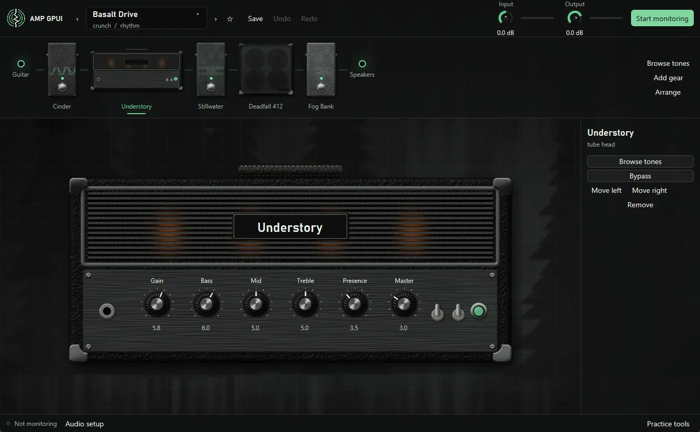

# Amp GPUI

Amp GPUI is a desktop guitar amp and effects rig written in Rust. Plug a guitar
into an audio interface, load a tone, and play through your speakers. There is
no pedal or modeler box in between.

Amps can be [Neural Amp Modeler](https://www.neuralampmodeler.com/) captures
(`.nam` files) or the built-in Understory amp, which needs no files at all.
Cabinets are impulse responses (`.wav` files) or the built-in cabinet voice.
Tones live in a plain folder that you own and can share however you like.

-   **[User guide](guide/index.md)**

    Install the app, connect your interface, get your latency down, and start
    playing.

-   **[How it works](internals/index.md)**

    The architecture, the audio path, the signal chain, and the preset format.

## What's in it

- **Live monitoring first.** Through ASIO, a Behringer FLOW 8 reports about
  8 ms from input to output. See [Monitoring and latency](guide/monitoring.md).
- **A rig you can see.** Realistic gear art in a chain strip, with the selected
  unit up close on a stage. Put gear in any order, with undo and redo, and hear
  each edit without a click.
- **A Tone Explorer** with search, tags, favorites, and recent tones.
- **A [tone generator](guide/generate.md).** Describe a sound and Claude builds a
  full signal chain you can import.
- **14 factory tones** from clean to fuzz, made only from built-in blocks, so
  they play on a fresh install.
- **Your own tone library.** It's a folder of JSON and files named by content
  hash, so it works in git, on a synced drive, or on a network share.
- **Practice tools:** a tuner, a metronome, and a fretboard that shows scales and
  lights up the notes you play.

!!! note "Windows only, for now"

    The low-latency audio code is written for Windows, and that's the only
    platform the app builds and runs on today. There are no prebuilt downloads
    yet, so you [build it from source](guide/install.md).
