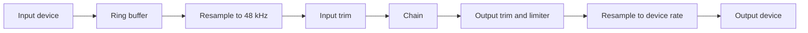

# Audio path

The main use case is a guitar in one device and speakers on another, so the
engine treats input and output as two separate clocks, even when they're the same
hardware.

## Input to queue

The input callback copies one channel, the one set by **Channel**, into a
16,384-frame lock-free ring buffer. That's all it does. All the processing runs on
the output side, driven by the output device asking for samples. This object is
called the `Pump` (`crates/amp-engine/src/pump.rs`).

## Why the chain always runs at 48 kHz

The chain has one fixed rate, `ENGINE_RATE`, whatever the devices use. NAM captures
are almost always 48 kHz, and `nam-rs` doesn't resample. Keeping the chain fixed
also means the two devices can run at different rates without anything downstream
noticing.

It runs in 64-frame blocks, about 1.3 ms. That size is a latency floor of its own,
so it stays small.

## Resampling

Both conversions use a cubic Hermite interpolator
(`crates/amp-engine/src/resampler.rs`). It holds four samples and adds about two
samples of delay, where a filter-based resampler would add dozens. A cubic does
worse near the top of the band, but a guitar has little energy up there, and
every sample of delay is felt under the fingers.

## Keeping two clocks together

Two independent devices never run at exactly the same speed. Left alone, the queue
between them slowly empties, which clicks, or slowly fills, which adds latency
that keeps growing.

So the pump measures the queue depth, smooths it, and nudges the input resampling
ratio to hold the depth at a target. The correction is 0.5% for a 480-frame error,
capped at 1%. That's well below anything you could hear on a guitar, and it still
drains such an error in a few seconds.

| Situation | What the pump does |
| --- | --- |
| Queue slightly off target | Nudges the input ratio |
| Queue runs dry | Fills with silence, counts a glitch, and raises the target by 48 frames |
| A burst of dropouts | Raises the target once at most per 100 ms, so one stall doesn't buy a lot of lasting delay |
| Queue far too full, after a stall | Throws away the backlog and counts a glitch |
| Output starts before input | Waits, and doesn't count it as a glitch |

The target starts small and grows only when it has to, up to a limit of 4,800
frames. Dropping the backlog looks harsh, but one glitch beats a long delay under
every note after it.

The starting target depends on the route: 240 frames for shared mode, one device
period for exclusive mode, and one driver buffer for ASIO.

## Around the chain

The `Processor` (`crates/amp-engine/src/processor.rs`) wraps the chain. For each
block, it does these things in order:

1. Applies any waiting commands from the UI.
2. Copies the raw signal to the tuner, if the tuner is open. This happens before
   the trim, so the tuner works with the input turned down.
3. Applies the input trim, gliding over about 10 ms to avoid zipper noise.
4. Records the input peak.
5. Runs the chain, and crossfades if it was just swapped.
6. Applies the output trim and the safety limiter.
7. Records the output peak.

The limiter leaves everything below 0.9 alone. Above that it bends peaks toward
full scale with a `tanh` curve, so a stray transient can't hard-clip at the
speakers.

## How latency adds up

The readout is three numbers added together (`Latency` in
`crates/amp-engine/src/processor.rs`):

- **Input device:** what the input driver reports
- **Queue:** the smoothed queue depth, as time
- **Output device:** what the output driver reports

Only what the drivers report is counted, so the true total can be higher,
especially when something downstream adds its own delay.
