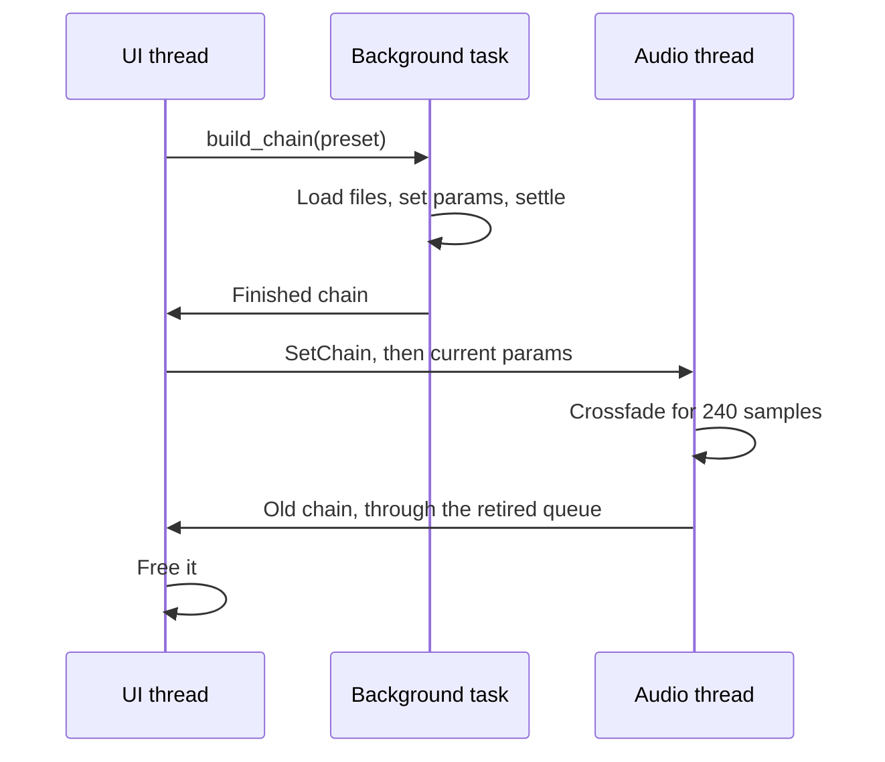

# Signal chain

A `Chain` (`crates/amp-dsp/src/chain.rs`) is an ordered list of blocks. Each slot
holds a boxed `Block` and a bypass flag. The engine owns exactly one chain at a
time.

## The Block trait

Every processor implements one small trait:

```rust
pub trait Block: Send {
    /// Sets the parameter at `index` in this kind's `BlockKind::params`.
    fn set_param(&mut self, index: usize, value: f32);

    /// Processes `buffer` in place, on the audio thread.
    fn process(&mut self, buffer: &mut [f32]);

    /// Returns to silence, dropping tails and history.
    fn reset(&mut self);
}
```

Audio is mono from end to end. The output is copied to every device channel.

## Processing

`Chain::process` runs each active block over the buffer in place, in slices of at
most 1,024 samples, so blocks can size their scratch space ahead of time.

After each slice, it checks for NaN or infinity. Such a sample would stay in every
feedback path forever, so the chain resets itself and silences the buffer instead
of passing it to the speakers.

## How edits reach the audio thread

There are two kinds of edit, depending on whether the chain's shape changes.

**Small edits** go through a lock-free command queue of 256 entries and apply
between blocks. They don't touch the chain's structure:

- `SetParam` for a knob
- `SetBypassed` for a footswitch
- `SetInputGain` and `SetOutputGain` for the level knobs

**Structural edits** rebuild the whole chain. Adding, moving, or removing a unit,
loading a cabinet, undoing, and loading a tone all work this way.



The pieces of this sequence each exist for a reason:

- **Only the newest build counts.** Each build has a number, and a slow one can't
  overwrite a newer edit if it finishes late.
- **Knobs may move during a build.** So after sending the chain, the UI sends every
  current parameter again.
- **A new chain is settled first.** `Chain::settle` runs 120 ms of silence through
  it, so smoothed controls reach their values. Without this, a new chain starts at
  unity gain and is too loud for a few milliseconds, which you'd hear as a pop on
  every edit.
- **Captures warm up off the audio thread.** The model's startup transient runs
  during loading.
- **Swaps crossfade.** The old chain keeps running for 240 samples, 5 ms, while the
  new one fades in. That's long enough not to click mid-note, and short enough to
  feel instant.
- **Old chains are freed on the UI thread.** Dropping one on the audio thread would
  free memory there, so it goes back through a queue. If that queue is full, the
  audio thread holds it and takes no new chain until there's room.

When loading a tone, the chain is built first, and the tone is adopted only if
every file loads. A bad file leaves the current tone playing.

## The chain strip and the chain

The UI's chain strip is a view of the `Preset`, and a slot on the strip is the same index
as a slot in the chain. That's what lets a `SetParam` command address a knob by
slot and parameter number.

Undo keeps up to 64 copies of the preset. A step restores a copy and rebuilds the
chain. Consecutive changes to the same knob count as one step.
