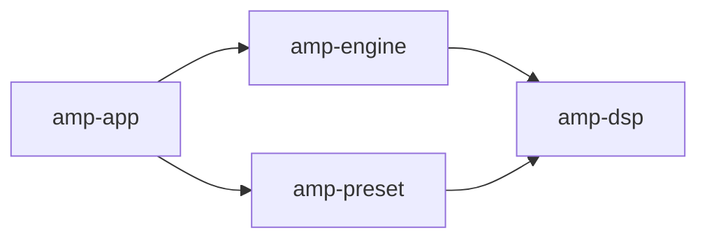
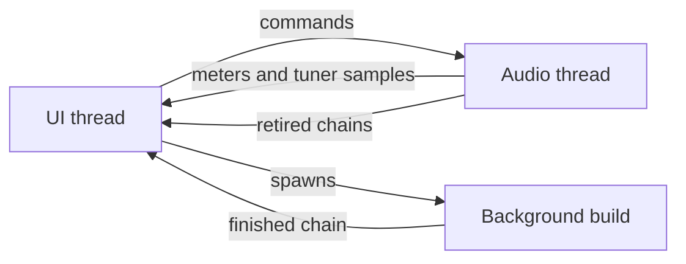

# How it works

Amp GPUI is a Rust workspace of four crates. Each page in this section takes one
part of the system and explains how it works and why it's built that way.

## The crates

| Crate | Job | Runs on |
| --- | --- | --- |
| `amp-dsp` | The blocks and the chain: amp, cabinet, drives, effects, tuner | Audio thread |
| `amp-engine` | Devices, resampling, clock drift, and messaging between the UI and audio threads | Audio thread and UI thread |
| `amp-preset` | Preset format, tone library, tone packs, factory tones | Background threads |
| `amp-app` | The GPUI interface | UI thread |

Dependencies run in one direction. `amp-preset` and `amp-engine` both build on
`amp-dsp`, and `amp-app` ties everything together.

`amp-dsp` knows nothing about devices or the UI. `amp-engine` has no idea what a
preset is. That split is what makes the audio code testable: the tests drive the
processor directly, with no audio hardware.

## The three kinds of thread

The whole design follows from one rule: **nothing on the audio thread allocates,
locks, or blocks.** A real-time thread that waits on anything can miss its
deadline, and a missed deadline is a click in your speakers.

- **The UI thread** handles the window and input. It polls the meters every 50 ms.
- **The audio thread** runs the chain. It only talks to the other threads through
  lock-free queues and atomics.
- **Background tasks** do anything slow, such as reading a model file. A finished
  chain reaches the audio thread as one boxed pointer.

## Key libraries

| Library | Used for |
| --- | --- |
| [gpui-kit](https://crates.io/crates/gpui-kit) | The interface |
| [nam-rs](https://crates.io/crates/nam-rs) | NAM inference, in pure Rust |
| [cpal](https://crates.io/crates/cpal) | Device listing, WASAPI shared mode, and ASIO |
| [windows](https://crates.io/crates/windows) | WASAPI exclusive mode, opened directly |
| [rtrb](https://crates.io/crates/rtrb) | Lock-free ring buffers |
| [fft-convolver](https://crates.io/crates/fft-convolver) | Cabinet convolution |
| [hound](https://crates.io/crates/hound) | Reading WAV files |

## Read next

- [Audio path](audio-path.md): how a sample gets from your guitar to your speakers
- [Audio drivers](drivers.md): the three routes and what each one costs
- [Signal chain](chain.md): how blocks run and how edits reach them
- [Block reference](blocks.md): what's inside each block, with parameter ranges
- [Presets and the library](presets.md): file formats and sharing
- [Work on the code](contributing.md): building, testing, and adding a block

<small>{ .asio-logo width="80" } ASIO is a registered trademark of Steinberg Media Technologies GmbH.</small>
